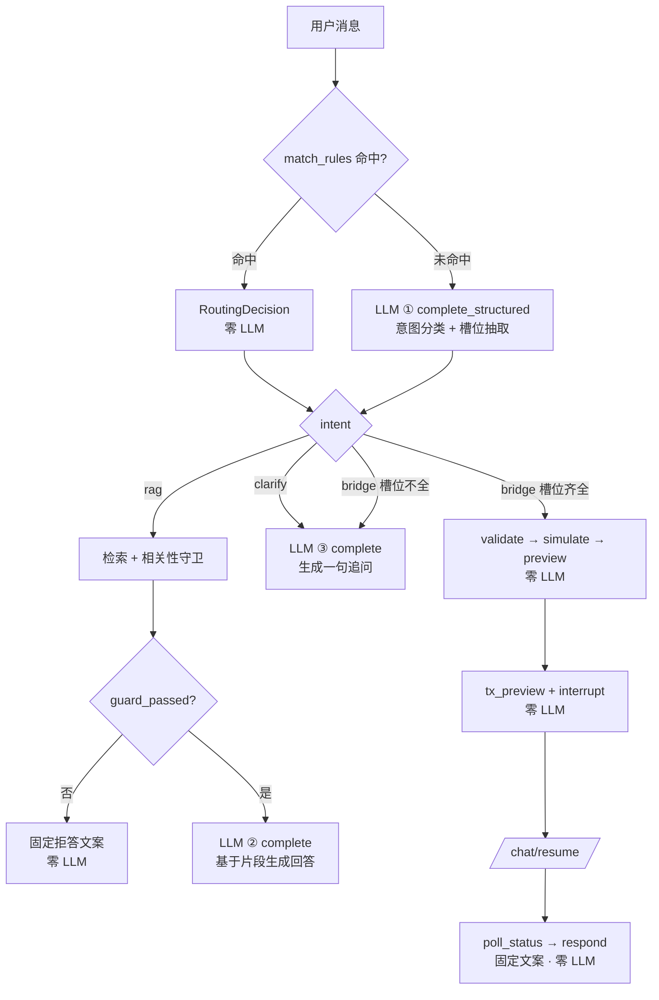

# Wanchain Agent 链路走读：从一次 RAG 问答到一次跨链请求

> 文档版本：v1.1  
> 更新日期：2026-11-19  
> 对应代码：`src/wanchain_agent/`（FastAPI 0.163 + LangGraph 1.2）  
> 目标：用两个真实请求，把「网关 → 编排 → 领域模块 → 适配器」每一跳的职责、数据形态和失败方式讲清楚

---

## 0. 先看全景

系统只有一条 HTTP 入口，内部是一个 LangGraph 状态机。所有能力都挂在同一个入口后面，靠路由分流。

```text
POST /chat (SSE)
      │
      ▼
 app.py            只做三件事：入参校验、执行图、把状态编码成 SSE
      │
      ▼
 orchestration/    entry → router → 三条分支 → respond
      │
      ├── knowledge/   检索 + 相关性守卫（RAG 分支）
      ├── bridge/      校验 + 模拟 + 预览（Bridge 分支）
      └── routing/     规则优先、LLM 兜底（路由层）
      │
      ▼
 adapters/         LLM、Chroma、SiliconFlow、Wanchain Bridge API
```

依赖方向是单向的：

```text
app.py → orchestration/ → routing/ knowledge/ bridge/ → core/（models、ports、errors）
                                              ▲
                                       adapters/ 实现 core/ports.py 里的 Protocol
```

`core/` 只依赖标准库和 Pydantic，不导入 LangChain、httpx、chromadb。换模型厂商、换向量库、换跨链 API，只改 `adapters/`。

| 层 | 目录 | 在链路中的角色 |
|---|---|---|
| 网关 | [app.py](file:///e:/one_chat/src/wanchain_agent/app.py) | HTTP/SSE 协议边界，无业务规则 |
| 编排 | [orchestration/](file:///e:/one_chat/src/wanchain_agent/orchestration/graph.py) | 状态机拓扑、节点实现、检查点 |
| 路由 | [routing/](file:///e:/one_chat/src/wanchain_agent/routing/rules.py) | 意图分类与槽位抽取 |
| 知识 | [knowledge/](file:///e:/one_chat/src/wanchain_agent/knowledge/pipeline.py) | 检索结果排序去重、相关性守卫 |
| 跨链 | [bridge/](file:///e:/one_chat/src/wanchain_agent/bridge/validator.py) | 纯函数校验、模拟自洽检查、预览组装 |
| 契约 | [core/](file:///e:/one_chat/src/wanchain_agent/core/models.py) | Pydantic 数据模型、端口 Protocol、错误码 |
| 适配器 | [adapters/](file:///e:/one_chat/src/wanchain_agent/adapters/) | 第三方 SDK 与网络 I/O 的唯一出口 |

---

## 1. 两个例子

后面所有步骤都围绕这两条请求展开。

**例 A：RAG 问答**

```http
POST /chat
Content-Type: application/json

{
  "session_id": "demo-rag-001",
  "message": "Storeman 如何保证跨链交易安全？"
}
```

**例 B：跨链请求**

```http
POST /chat
Content-Type: application/json

{
  "session_id": "demo-bridge-001",
  "message": "帮我把 100 USDT 从 ETH 跨到 BSC，收款地址 0x1111111111111111111111111111111111111111"
}
```

注意：例 B 的收款地址不是可选装饰。`BridgeSlots.REQUIRED_FIELDS` 只包含链、代币、金额，但构建交易载荷时必须有 `recipient`，缺失会在校验阶段报 `bridge_validation`（见 3.3 节）。

两个请求共用同一段入口代码：

```python
# app.py
@app.post("/chat")
async def chat(payload: ChatRequest) -> StreamingResponse:
    return StreamingResponse(
        _stream(
            graph,
            session_id=payload.session_id,
            run_input=initial_state(
                session_id=payload.session_id, message=payload.message
            ),
        ),
        media_type="text/event-stream",
        headers=SSE_HEADERS,
    )
```

`ChatRequest` 会先做 Pydantic 校验（`session_id` 1–64 字符、`message` 1–4000 字符），不合法直接返回 422，不会进入图。

---

## 2. 例 A：RAG 问答的完整链路

### 2.1 旅程总览

```text
Client ──POST /chat──▶ app.py ──▶ entry ──▶ router ──▶ knowledge_retrieve
                                                          │
                                                          ▼
                                                        guard
                                                          │
                                                          ▼
                                                       respond ──▶ SSE: token + citations
```

### 2.2 离线准备（不在请求路径上）

线上检索能工作，前提是离线阶段已经完成两段构建：

| 阶段 | 入口 | 产物 | 关键约束 |
|---|---|---|---|
| 清洗 + 切分 | `python -m wanchain_agent.knowledge.build_index` | `data/processed/chunks.jsonl`、`manifest.json` | 每行一个 `Chunk`，`chunk_id` 幂等，记录语料哈希与切分参数 |
| 向量化 + 写库 | `python -m wanchain_agent.indexing` | `data/chroma`、`data/processed/index_manifest.json` | 向量条数/维度必须与片段一致，写入条数必须等于片段数 |

索引清单会记录 `embedding.model_name`、`embedding.dimension`、`chunks.sha256`。启动时 [knowledge_chroma.py](file:///e:/one_chat/src/wanchain_agent/adapters/knowledge_chroma.py#L98-L127) 会拿当前配置和清单比对，不一致直接抛 `ConfigError`，避免“能跑但检索不准”。

### 2.3 逐跳拆解

#### Step 1 · 网关：把消息变成初始状态

[app.py](file:///e:/one_chat/src/wanchain_agent/app.py#L201-L212) 调用 `_stream`，后者执行：

```python
state = await graph.ainvoke(run_input, thread_config(session_id))
```

`initial_state` 只放两个字段：

```python
GraphState(
    session_id="demo-rag-001",
    messages=[{"role": "user", "content": "Storeman 如何保证跨链交易安全？"}],
)
```

`thread_config` 把 `session_id` 映射成 LangGraph 的 `thread_id`。历史消息由检查点按 `thread_id` 合并，`messages` 字段带 `add` reducer，每轮只追加。

#### Step 2 · entry：清理上一轮的瞬时字段

[nodes.py](file:///e:/one_chat/src/wanchain_agent/orchestration/nodes.py#L99-L117) 的 `entry` 节点不做业务，只做两件事：

- 生成或复用 `trace_id`；
- 把 `routing_decision`、`rag_context`、`guard_passed`、`tx_preview`、`approval`、`error` 等字段显式重置为 `None`，防止上一轮的预览或错误泄漏到本轮。

不清理会出什么问题：用户上一轮生成了待确认预览，这一轮问文档问题，`_state_events` 可能仍然看到旧的 `tx_preview` 并发出去。

#### Step 3 · router：规则先判，LLM 兜底

[nodes.py](file:///e:/one_chat/src/wanchain_agent/orchestration/nodes.py#L120-L126) 把最新一条用户消息交给 `route()`：

```python
decision = await route(_last_user_content(state), deps.llm)
return {"routing_decision": decision.model_dump(mode="json")}
```

[rules.py](file:///e:/one_chat/src/wanchain_agent/routing/rules.py#L57-L87) 的判断过程：

1. 抽取链名：`_extract_chains` 命中 0 个；
2. 抽取金额与代币：`_extract_amount` 返回 `(None, None)`；
3. `transfer_signal`：消息含“跨链”，为 `True`；
4. `bridge_signal`：链数不足 2 且没有交易参数，为 `False`；
5. `_is_question`：消息含“如何”，为 `True`。

结果：

```json
{
  "intent": "rag",
  "confidence": 1.0,
  "slots": null,
  "reason": "rule:rag"
}
```

这里体现了路由层的核心取舍：**“跨链”这个词本身不足以进入交易分支**，否则“Storeman 如何保证跨链安全”会被误送进 Bridge。只有同时满足「两条链 + 交易意图」或「金额/代币 + 转账关键词」才算跨链请求。

如果规则返回 `None`，才调用 LLM：

```python
return await llm.complete_structured(messages, RoutingDecision)
```

`complete_structured` 会追加 JSON Schema 指令、开启 `response_format={"type": "json_object"}`，再用 Pydantic 校验。模型输出不合法直接抛 `UpstreamError`，不会把半结构化结果带进图。

#### Step 4 · knowledge_retrieve：检索、排序、去重

[graph.py](file:///e:/one_chat/src/wanchain_agent/orchestration/graph.py#L100-L110) 根据 `intent == "rag"` 把控制流送到 `knowledge_retrieve`，节点调用 [pipeline.py](file:///e:/one_chat/src/wanchain_agent/knowledge/pipeline.py#L15-L35)：

```python
citations = await knowledge.retrieve(text, top_k=5)
return sorted_by_score_and_dedupe(citations, top_k=5)
```

适配器 [knowledge_chroma.py](file:///e:/one_chat/src/wanchain_agent/adapters/knowledge_chroma.py#L48-L75) 做三件事：

1. `await embedding.embed_query(text)`：调用 SiliconFlow 的 `BAAI/bge-m3`，得到 1024 维查询向量；
2. `store.search_embeddings([vector], top_k=5)`：Chroma 余弦检索；
3. 把 Chroma 的**余弦距离**转成**相似度** `1 - distance`，并映射成 `Citation`。

```python
Citation(
    doc_id=meta["doc_id"],
    source_path=meta["source_path"],
    heading_path=meta["heading_path"],
    snippet=document.content,
    score=1.0 - document.score,
)
```

`pipeline.rank` 再按 `doc_id` 去重，只保留同一文档的最高分片段。这样引用列表里不会出现同一篇文档的多个近似片段。

节点把结果写回状态：

```python
{"rag_context": [citation.model_dump(mode="json"), ...]}
```

#### Step 5 · guard：分数不达标就拒答

[guard.py](file:///e:/one_chat/src/wanchain_agent/knowledge/guard.py#L16-L23) 只做一件事：

```python
guard_passed = bool(citations) and max(c.score for c in citations) >= 0.5
```

阈值来自配置 `MIN_RELEVANCE`，默认 `0.5`。这个数字必须和 `bge-m3 + cosine` 这组后端一起调，换向量库或换模型后不能沿用。

结果写入 `state["guard_passed"]`。注意它不影响图的分支，只影响两处：

- `respond` 是否把检索上下文交给 LLM；
- `_state_events` 是否发送 `citations` 事件。

#### Step 6 · respond：组装上下文并生成回答

[nodes.py](file:///e:/one_chat/src/wanchain_agent/orchestration/nodes.py#L246-L267) 的 `_compose_answer`：

```python
if intent == "rag":
    if not state.get("guard_passed"):
        return REFUSAL_TEXT
    context = "\n\n".join(
        f"[{item['source_path']}] {item['snippet']}" for item in state["rag_context"]
    )
    return await deps.llm.complete([
        {"role": "system", "content": ANSWER_SYSTEM_PROMPT.format(context=context)},
        *state["messages"],
    ])
```

系统提示词明确要求“只能依据给定文档片段回答，片段不足时说明无法回答，不要编造”。返回文本以 assistant 消息写回：

```python
{"messages": [{"role": "assistant", "content": text}]}
```

#### Step 7 · 网关：状态映射成 SSE

图执行结束后，[app.py](file:///e:/one_chat/src/wanchain_agent/app.py#L79-L104) 的 `_state_events` 按固定优先级判断：

```python
if state.get("error"):          return [error]
if "__interrupt__" in state and preview: return [tx_preview, interrupt]
if last assistant message:      return [token] (+ citations if guard_passed)
```

例 A 的实际响应：

```text
event: token
data: {"text":"Storeman 通过 MPC 门限签名与抵押机制保障跨链资产安全……"}

event: citations
data: {"citations":[{"doc_id":"technology/storeman-nodes","source_path":"corpus/technology/storeman-nodes.md","heading_path":"Storeman > 安全机制","snippet":"...","score":0.82}]}
```

连接关闭即表示本轮结束，没有 `done` 事件。

### 2.4 例 A 的失败分支

| 触发条件 | 图内行为 | SSE 结果 |
|---|---|---|
| 检索无结果或最高分 < 0.5 | `guard_passed=False`，`respond` 返回固定拒答文案 | 只有 `token`，没有 `citations` |
| Embedding/Chroma 网络异常 | 适配器抛 `UpstreamError`，`catching` 收敛为 `state["error"]` | 只有 `error`，`code=upstream` |
| LLM 调用失败或返回空内容 | `respond` 抛 `UpstreamError`，同上 | 只有 `error`，`code=upstream` |
| LLM 结构化输出不合 Schema | 仅发生在路由兜底，`UpstreamError` | 只有 `error`，`code=upstream` |

一个容易忽略的细节：`catching` 只捕获 `AgentError`。如果节点抛出 Pydantic `ValidationError` 这类非领域异常，会一路冒到 `_stream` 的兜底 `except Exception`，最终变成 `code=internal`。

---

## 3. 例 B：跨链请求的完整链路

### 3.1 旅程总览

```text
Client ──POST /chat──▶ entry ──▶ router ──▶ bridge_validate ──▶ bridge_simulate
                                                              │
                                                              ▼
                                                        bridge_preview
                                                              │
                                                              ▼
                                                        await_approval  ⏸ 图暂停
                                                              │
Client ──POST /chat/resume──▶ await_approval 恢复 ──▶ bridge_poll ──▶ respond
```

### 3.2 逐跳拆解

#### Step 1 · router：规则抽取槽位

同一个 `route()`，这次走跨链分支。[rules.py](file:///e:/one_chat/src/wanchain_agent/routing/rules.py#L57-L87) 的判断：

- 链名：命中 `ETH`、`BSC`，共 2 条；
- 金额与代币：`_AMOUNT_WITH_TOKEN_RE` 命中 `100 USDT`；
- `transfer_signal`：消息含“跨到”，为 `True`；
- `bridge_signal`：两条链成立。

槽位组装由 `_build_slots` 完成：

```json
{
  "from_chain": "ETH",
  "to_chain": "BSC",
  "token": "USDT",
  "amount": "100",
  "recipient": "0x1111111111111111111111111111111111111111"
}
```

几个实现细节：

- 链名按出现顺序取前两个，第一个作源链、第二个作目标链；
- 只出现一条链时，看它前面是否紧跟“到 / 至 / to”，决定它是目标链还是源链；
- “100 WAN”里的 `WAN` 是代币，不参与链名识别；
- 金额用 `Decimal` 解析，`_to_amount` 会拒绝 `<= 0` 的值；
- 收款地址只在出现“收款地址 / 接收地址 / 到地址 / recipient”时才抽取，不会把消息里第一个地址猜成收款方。

#### Step 2 · 分支判定：只看槽位是否齐全

[graph.py](file:///e:/one_chat/src/wanchain_agent/orchestration/graph.py#L43-L55)：

```python
if intent == "bridge":
    slots = decision.get("slots") or {}
    if all(slots.get(field) for field in BridgeSlots.REQUIRED_FIELDS):
        return "bridge_validate"
    return "clarify"
```

`confidence` 不参与判断。模型自评分没有经过概率校准，不能作为放行依据。

例 B 四个必填槽位齐全，进入 `bridge_validate`。

#### Step 3 · bridge_validate：本地纯函数 + 只读路由确认

[nodes.py](file:///e:/one_chat/src/wanchain_agent/orchestration/nodes.py#L170-L180) 先做本地校验，再问外部 API：

```python
slots = _slots(state)              # 反序列化 + 完整性检查
validate_slots(slots)              # 纯函数，不访问网络
check = await deps.bridge.validate_route(slots)
if not check.supported:
    raise BridgeValidationError(check.reason or "该跨链路由不受支持")
```

[validator.py](file:///e:/one_chat/src/wanchain_agent/bridge/validator.py#L37-L69) 的检查顺序：

1. 四个必填槽位不能为空；
2. 源链不能等于目标链；
3. 代币与链的组合必须支持：`USDC` 不能碰 `WAN`，`WAN` 只能与 `WAN` 组合；
4. 小数位不能超过代币精度：USDT/USDC 6 位，WAN 18 位；
5. 金额不能低于最小值：USDT/USDC 1，WAN 10。

全部通过后调用 [bridge_wanchain.py](file:///e:/one_chat/src/wanchain_agent/adapters/bridge_wanchain.py#L174-L184)：

```python
data = await self._create_tx(slots)
return RouteCheck(supported=True, min_amount=..., decimals=6)
```

`_create_tx` 把内部枚举翻译成官方 API 的字段：

```json
{
  "fromChain": "ETH",
  "toChain": "BNB",
  "fromToken": "0xdac17...",
  "toToken": "0x55d3...",
  "fromAccount": "0x...",
  "toAccount": "0x1111...",
  "amount": "100"
}
```

注意 BSC 的 `chainType` 是 `BNB`，映射表在适配器里维护，不外泄到领域层。`fromAccount` 是官方接口的必填字段，来自 `BRIDGE_FROM_ACCOUNT`；未配置时适配器直接抛 `bridge_validation`，而不是等接口返回 400。接口返回的 `chainId` 可能是 `"0x1"` 这样的十六进制字符串，适配器会统一解析成整数。

`_create_tx` 结果按请求键做 60 秒短 TTL 缓存。所以后面的 `simulate` 和 `build_unsigned_tx` 不会重复打三次网络请求。

#### Step 4 · bridge_simulate：模拟并做自洽检查

[simulator.py](file:///e:/one_chat/src/wanchain_agent/bridge/simulator.py#L14-L34)：

```python
result = await bridge.simulate(slots)   # 命中上一步缓存
if result.bridge_fee + result.estimated_receive > amount:
    raise SimulationFailedError("模拟结果自相矛盾")
```

适配器侧 [bridge_wanchain.py](file:///e:/one_chat/src/wanchain_agent/adapters/bridge_wanchain.py#L186-L202)：

```python
receive = Decimal(data.receiveAmount)
fee = amount - receive if amount > receive else Decimal(0)
expires_at = datetime.now(UTC) + timedelta(seconds=120)
```

`estimated_gas` 只取 `networkFee` 且非百分比的情况；百分比费用无法折算成绝对值，返回 `None`，不做猜测。

自洽检查的意义：外部 API 返回的 `receiveAmount` 如果大于输入金额，或手续费与到账之和超过输入，说明数据不可信，宁可失败也不生成预览。

#### Step 5 · bridge_preview：组装唯一可信的预览

[nodes.py](file:///e:/one_chat/src/wanchain_agent/orchestration/nodes.py#L192-L201)：

```python
payload = await deps.bridge.build_unsigned_tx(slots)
preview = build_preview(slots, simulation, payload)
```

[preview.py](file:///e:/one_chat/src/wanchain_agent/bridge/preview.py#L19-L43) 只做字段组装，**不重算费用、不四舍五入**。预览里的 `bridge_fee`、`estimated_receive` 必须来自同一次模拟结果，否则用户签名的依据和展示的数字可能不一致。

产物 `TxPreview` 的金额字段都是 `Decimal`，序列化成普通十进制字符串（禁止科学计数法），例如：

```json
{
  "from_chain": "ETH",
  "to_chain": "BSC",
  "token": "USDT",
  "amount": "100",
  "bridge_fee": "0.35",
  "estimated_receive": "99.65",
  "estimated_gas": null,
  "unsigned_payload": {
    "to": "0x...",
    "data": "0x...",
    "value": "0",
    "chain_id": 1,
    "gas_limit": null
  },
  "expires_at": "2026-11-19T10:32:00+00:00"
}
```

`unsigned_payload` 是服务端能给出的最后一环。私钥、签名、广播都不在系统边界内。

#### Step 6 · await_approval：中断并落检查点

[nodes.py](file:///e:/one_chat/src/wanchain_agent/orchestration/nodes.py#L204-L222)：

```python
decision = interrupt({"type": "tx_preview", "data": state["tx_preview"]})
```

`interrupt()` 会让 LangGraph 暂停当前线程，把检查点写入 Redis（`thread_id = session_id`），`ainvoke` 返回时状态里带 `__interrupt__`。

网关据此发送两条事件：

```text
event: tx_preview
data: {"preview":{...}}

event: interrupt
data: {"session_id":"demo-bridge-001","type":"tx_preview"}
```

顺序固定：先预览，再暂停信号。`interrupt` 只在等待人工确认时出现，澄清追问不会用它。

#### Step 7 · /chat/resume：恢复执行

[app.py](file:///e:/one_chat/src/wanchain_agent/app.py#L214-L233) 在建立流之前先做两项检查：

```python
snapshot = await graph.aget_state(config)
if not snapshot.values:
    raise SessionNotFoundError("会话不存在或已过期")      # HTTP 404
if not snapshot.next:
    raise SessionNotFoundError("该会话没有等待确认的交易预览")  # HTTP 404
```

这两类失败发生在 `StreamingResponse` 之前，所以返回的是普通 JSON 404，不是 SSE `error` 事件。

恢复输入：

```python
Command(resume={"approved": True, "tx_hash": "0x..."})
```

`await_approval` 恢复后按顺序处理：

1. `is_expired(preview)`：过期直接抛 `PreviewExpiredError`；
2. `approved=False`：写 `{"approval": {"approved": False}, "tx_hash": None}`；
3. `approved=True`：写 `{"approval": {"approved": True}, "tx_hash": ...}`。

随后 [graph.py](file:///e:/one_chat/src/wanchain_agent/orchestration/graph.py#L65-L70) 决定下一跳：

- 批准 → `bridge_poll`；
- 拒绝或报错 → `respond`。

`bridge_poll` 调用 `poll_status(tx_hash)`，把官方状态映射为内部枚举（`PENDING` / `SUCCESS_MINTED` / `FAILED` / `UNKNOWN`），最后 `respond` 返回：

```text
批准：跨链状态：PENDING
拒绝：已取消本次跨链操作，没有生成任何待签名交易。
```

两种情况都只产生 `token` 事件。**恢复不会重发 `tx_preview` / `interrupt`**，它恢复的是图执行，不是重放预览。

### 3.3 例 B 的失败分支

| 触发条件 | 触发位置 | 结果 |
|---|---|---|
| 缺链/代币/金额 | `_route_after_router` | 走 `clarify`，`token` 追问缺失字段 |
| 缺收款地址 | `bridge_validate` 适配器组装请求体 | `error`，`code=bridge_validation` |
| 未配置 `BRIDGE_FROM_ACCOUNT` | `bridge_validate` 适配器组装请求体 | `error`，`code=bridge_validation` |
| 源链 = 目标链（规则路径） | `_build_slots` 把 `to_chain` 置空 | 转 `clarify`，不静默改写 |
| 小数位超限 / 低于最小额 | `validate_slots` | `error`，`code=invalid_amount` |
| 代币与链不兼容 | `_check_token_chain` | `error`，`code=unsupported_token` |
| 官方 API 拒绝或不可达 | `WanchainBridgeAdapter._request` | `error`，`code=upstream` |
| 模拟结果不自洽 | `simulator.simulate` | `error`，`code=simulation_failed` |
| 恢复时预览已过期 | `await_approval` | `error`，`code=preview_expired` |
| 批准但缺 `tx_hash` | `bridge_poll` | `error`，`code=bridge_validation` |
| 会话不存在或无待确认预览 | `/chat/resume` 入流前 | JSON 404，不是 SSE |

> 契约差异提示：评测计划里写的“不支持路由 → 领域校验错误”，在端口返回 `supported=False` 时是 `bridge_validation`；但官方 API 明确拒绝时，适配器当前抛的是 `upstream`。如果评测要断言 `code`，需要先统一这一处，或在用例里接受两种码。

---

## 4. 两个例子的状态流转对照

同一套 `GraphState`，两条链路填的字段不同。

| 节点 | 写入字段 | 例 A（RAG） | 例 B（Bridge） | 对应事件 |
|---|---|---|---|---|
| `entry` | `trace_id`，清空瞬时字段 | `trace_id` | `trace_id` | — |
| `router` | `routing_decision` | `intent=rag` | `intent=bridge` + 完整槽位 | — |
| `knowledge_retrieve` | `rag_context` | 5 条 `Citation` | — | — |
| `guard` | `guard_passed` | `True`（最高分 ≥ 0.5） | — | — |
| `bridge_validate` | 无写入，失败写 `error` | — | 通过或 `error` | — |
| `bridge_simulate` | `simulation` | — | 费用、到账、过期时间 | — |
| `bridge_preview` | `tx_preview` | — | 完整预览 | `tx_preview` + `interrupt` |
| `await_approval` | `approval`、`tx_hash` | — | 恢复后写入 | — |
| `bridge_poll` | `bridge_status` | — | `PENDING` 等 | — |
| `respond` | `messages`（assistant） | 回答文本 | 状态文本 / 取消文本 | `token` |
| 网关 | — | 依据 `guard_passed` 追加引用 | 依据 `__interrupt__` 发预览 | `citations` / `interrupt` |

由此可以记住一条规则：

> **节点只写状态，事件由网关读状态决定。** LLM 不返回“事件”，它只返回文本或 `RoutingDecision`。

---

## 5. 模块职责速查

| 模块 | 关键函数 | 输入 | 输出 | 原理 / 约束 |
|---|---|---|---|---|
| 网关 | `create_app`、`_stream`、`_state_events` | HTTP 请求 | SSE 字节流 | 无业务规则；异常统一转成 `error` 事件 |
| 入口节点 | `entry` | 上一轮状态 | 清理后的状态 | 防止旧预览、旧错误跨轮泄漏 |
| 路由节点 | `router` → `route` | 最新用户消息 | `RoutingDecision` | 规则优先；LLM 只在未命中时结构化分类 |
| 规则路由 | `match_rules` | 文本 | 决策或 `None` | 关键词 + 正则 + `Decimal`，毫秒级、零 token |
| 检索管道 | `retrieve`、`rank` | 查询、`KnowledgePort` | `list[Citation]` | 按分数降序，同一 `doc_id` 只留最高分 |
| 相关性守卫 | `guard_passed` | 引用列表 | `bool` | 最高分与阈值比较，阈值随后端校准 |
| 回答生成 | `_compose_answer` | 状态 + `LLMPort` | 文本 | 只依据检索片段；不足则固定拒答 |
| 跨链校验 | `validate_slots` | `BridgeSlots` | `RouteCheck` | 100% 纯函数，不访问网络 |
| 跨链模拟 | `simulate` | 槽位 + `BridgePort` | `SimulationResult` | 校验费用与到账之和不超过输入 |
| 预览组装 | `build_preview` | 槽位、模拟、载荷 | `TxPreview` | 与模拟同源，不重算、不四舍五入 |
| 中断恢复 | `await_approval` | `Command(resume=...)` | `approval`、`tx_hash` | 先判过期，再采信用户决定 |
| LLM 适配器 | `complete`、`complete_structured` | 消息、Schema | 文本 / Pydantic 模型 | JSON 模式 + Schema 校验，异常转 `UpstreamError` |
| 检索适配器 | `retrieve` | 查询 | `Citation` | 距离转相似度；启动校验索引清单 |
| 跨链适配器 | `validate_route`、`simulate`、`build_unsigned_tx`、`poll_status` | 槽位 / 哈希 | 领域模型 | 只读 + 未签名载荷；60 秒请求缓存 |

---

## 6. LLM 调用链路

LLM 不是整条链路的默认参与者，只在三个位置被调用；其余环节全部是确定性代码。



三个调用点的细节：

| # | 位置 | 方法 | 输入 | 输出 | 触发条件 |
|---|---|---|---|---|---|
| ① | [router.py](file:///e:/one_chat/src/wanchain_agent/routing/router.py#L24-L36) | `complete_structured` | 用户消息 + `RoutingDecision` 的 JSON Schema | 结构化 `intent` 与 `slots` | 规则未命中 |
| ② | [nodes.py](file:///e:/one_chat/src/wanchain_agent/orchestration/nodes.py#L246-L267) | `complete` | 系统提示词 + 检索片段 + 历史消息 | 回答文本 | `intent=rag` 且 `guard_passed=True` |
| ③ | [nodes.py](file:///e:/one_chat/src/wanchain_agent/orchestration/nodes.py#L129-L147) | `complete` | 澄清提示词 + 缺失字段列表 | 一句追问 | `intent=clarify`，或 bridge 槽位不全 |

三个共同约束：

- 默认 `temperature=0`，评测时同一输入的方差只来自模型本身，不来自采样参数；
- 结构化输出走 JSON 模式 + Pydantic 校验，不合 Schema 直接抛 `UpstreamError`；
- 所有 SDK 异常在适配器层统一转成 `UpstreamError`，业务层看不到第三方异常类型。

### 6.1 每个例子调用了几次

| 场景 | 路由 | 生成 | 合计 |
|---|---|---|---|
| 例 A（规则命中 RAG） | 0（规则） | 1（回答） | **1** |
| 例 B（规则命中 Bridge） | 0（规则） | 0（固定文案） | **0** |
| 规则未命中的 Bridge | 1（结构化分类） | 0 | **1** |
| 缺槽位澄清 | 0 或 1 | 1（追问） | **1–2** |

所以例 B 是真正的“零 LLM”路径：听懂用户靠正则与枚举，参数校验靠纯函数，费用来自只读 API，文案是固定模板。

### 6.2 为什么把 LLM 限制在这三处

1. **可复现**：金额、链、代币、路由资格都不交给模型判断，评测时不会因为模型换版本而漂移。
2. **可归因**：失败时只需要判断“是没听懂（①③）”还是“业务规则/外部 API 出错（零 LLM 段）”，边界清晰。
3. **可省钱**：规则命中率高时，大部分请求不消耗 token；Bridge 主干完全零 token。
4. **可安全**：模型不接触签名材料，也不参与是否放行的决策，`confidence` 只作展示字段。

对应的评测策略也由此而来：Bridge 用例可以用 fixture 回放，做零成本、零方差的回归；RAG 与澄清用例才需要关注模型输出质量，并用 LLM Judge 抽样校准。

## 7. 设计取舍与已知缺口

### 7.1 为什么这样设计

1. **规则优先于模型**：能确定性判断的，不花 token，也不引入随机性。规则命中率越高，评测方差越小。
2. **`confidence` 不参与放行**：模型自评分没有校准，0.9 不代表 90% 正确。是否进跨链只看槽位是否齐全。
3. **金额只用 `Decimal`**：`core/models.py` 的 `_reject_float` 会在入参阶段直接拒绝 `float`，序列化统一为普通十进制字符串，避免浮点误差变成链上损失。
4. **预览与模拟同源**：`build_preview` 不重新计算费用，避免“展示一个数、签名另一个数”。
5. **服务端不碰签名材料**：`BridgePort` 的所有方法都是只读或构建未签名载荷，`UnsignedTxPayload` 是系统能给出的最后一环。
6. **事件语义集中在网关**：`_state_events` 一处定义优先级，评测断言只需要盯这一处，不用满图找 `yield`。

### 7.2 已知缺口（与评测计划一致）

| 缺口 | 具体表现 | 影响 |
|---|---|---|
| 路由不合并历史槽位 | `_last_user_content` 只取最新一条用户消息 | 多轮补槽（“从 ETH”作为第二轮）无法与上一轮合并，E2E-09 / E2E-16 依赖修复 |
| `token` 不是增量流式 | `graph.ainvoke` 跑完后一次性发送整段文本 | 首 token 延迟等于完整生成时间；改流式需同步改前端拼接与评测断言 |
| `recipient` 不在必填字段 | 缺地址时先通过完整性检查，到校验阶段才报错 | 用户本应得到澄清追问，实际得到 `bridge_validation` 错误 |
| 不支持路由的错误码不统一 | 端口拒绝是 `bridge_validation`，官方 API 拒绝是 `upstream` | 评测断言 `code` 时需要区分来源 |
| 澄清轮次不保存部分槽位 | `clarify` 只问缺失字段，未把已抽取槽位写回会话 | 即使路由修好，也需要配套的槽位持久化策略 |

---

## 8. 自己跑一遍

### 8.1 启动服务

```powershell
.\.venv\Scripts\python.exe -m uvicorn wanchain_agent.config:build_app --factory --reload --port 8000
```

`build_app` 会按环境变量装配 LLM、Chroma 检索、跨链适配器和检查点。本地默认 `CHECKPOINTER=memory`；要验证重启恢复，需要 `CHECKPOINTER=redis` 并配置 `CHECKPOINT_URL`。跨链预览还要求 `BRIDGE_FROM_ACCOUNT` 非空，否则会在校验阶段返回 `bridge_validation`。

### 8.2 RAG 请求

```powershell
curl.exe -N -X POST http://127.0.0.1:8000/chat `
  -H "Content-Type: application/json" `
  -d '{\"session_id\":\"demo-rag-001\",\"message\":\"Storeman 如何保证跨链交易安全？\"}'
```

预期依次看到 `token`、`citations` 两条事件；如果知识库外问题，只会看到 `token` 拒答。

### 8.3 跨链请求与恢复

```powershell
curl.exe -N -X POST http://127.0.0.1:8000/chat `
  -H "Content-Type: application/json" `
  -d '{\"session_id\":\"demo-bridge-001\",\"message\":\"帮我把 100 USDT 从 ETH 跨到 BSC，收款地址 0x1111111111111111111111111111111111111111\"}'
```

预期看到 `tx_preview`，紧接 `interrupt`，然后连接关闭。记下 `preview.expires_at`，在过期前恢复：

```powershell
curl.exe -N -X POST http://127.0.0.1:8000/chat/resume `
  -H "Content-Type: application/json" `
  -d '{\"session_id\":\"demo-bridge-001\",\"approved\":true,\"tx_hash\":\"0xabc...\"}'
```

预期只看到一条 `token`，内容为 `跨链状态：...`；不会再次出现 `tx_preview` 或 `interrupt`。

### 8.4 观察点

| 想确认的事 | 看哪里 |
|---|---|
| 路由走了规则还是 LLM | `RoutingDecision.reason`：`rule:rag` / `rule:bridge` 是规则，空字符串通常来自 LLM |
| 检索分数是否过阈值 | `citations[].score` 与 `MIN_RELEVANCE` |
| 是否命中了缓存 | 适配器日志或响应耗时；同一槽位 60 秒内 `createTx` 只打一次 |
| 是否真的中断了 | 响应里有 `interrupt`，且 `/chat/resume` 能读到 `snapshot.next` |
| 会话是否隔离 | 用两个不同 `session_id` 交叉请求，状态字段不应串线 |

---

## 9. 一页总结

- **一条入口**：`POST /chat` 把所有请求变成 LangGraph 的一次执行，SSE 只是状态的投影。
- **两种分支**：RAG 走「检索 → 守卫 → 生成」，Bridge 走「校验 → 模拟 → 预览 → 中断 → 轮询」。
- **三层契约**：`core/models.py` 定义数据，`core/ports.py` 定义能力，`adapters/` 提供实现。
- **两条红线**：金额只用 `Decimal`；服务端只产未签名载荷，永不接触私钥与广播。
- **一处事件语义**：`_state_events` 决定发什么事件，LLM 不参与协议。
